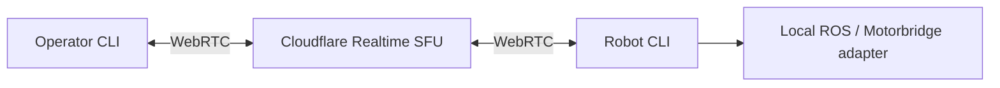

[](https://github.com/kyeshmz/inspect-robots-b601/blob/v0.3.0/docs/quickstart.md)

# inspect-robots-b601

<div align="center">

[](https://github.com/kyeshmz/inspect-robots-b601/actions/workflows/ci.yml)
[](https://github.com/kyeshmz/inspect-robots-b601/actions/workflows/quality.yml)
[](https://github.com/kyeshmz/inspect-robots-b601/actions/workflows/official-mock.yml)
[](https://github.com/robocurve/inspect-robots/releases/tag/v0.60.0)
[](https://github.com/robocurve)
[](https://wiki.seeedstudio.com/rebot_arm_b601_rs_ros2_integration/)
[](https://github.com/kyeshmz/inspect-robots-b601/blob/v0.3.0/CONTRIBUTING.md)
[](https://github.com/kyeshmz/inspect-robots-b601/blob/v0.3.0/docs/versioning.md)
[](https://huggingface.co/)

</div>

Seeed reBot Arm **B601-RS** embodiments and measured-state benchmarks for
[Inspect Robots](https://github.com/robocurve/inspect-robots).

**Independent community integration by kyeshmz.** Built for the RoboCurve
evaluation ecosystem and Seeed hardware; not an official endorsement or
sponsorship. [Banner source and attribution](https://github.com/kyeshmz/inspect-robots-b601/blob/v0.3.0/assets/NOTICE.md).

This standalone repository contains the adapters, the shared bounded joint1
commissioning core, regression tests, simulation evaluations and operator-only
physical test procedure. It does not include credentials, robot calibration,
stop-state files, ROS, vendor native binaries or a commissioned physical robot.

## Install with pip

Use Python **3.10–3.12** on Linux; ROS 2 Humble uses Ubuntu 22.04's system Python
3.10 and a virtual environment created with `--system-site-packages`.

```bash
python -m pip install 'inspect-robots-b601[realtime] @ https://github.com/kyeshmz/inspect-robots-b601/releases/download/v0.3.0/inspect_robots_b601-0.3.0-py3-none-any.whl'
b601-realtime --help
inspect-robots list embodiments
```

No Git checkout is required. You can also install from the public `v0.3.0` Git
tag. The short PyPI form `pip install inspect-robots-b601` requires the one-time
[trusted publisher setup](https://github.com/kyeshmz/inspect-robots-b601/blob/v0.3.0/docs/publishing.md); a GitHub release does not silently
publish to PyPI.

Optional extras: `[realtime]` installs the WebRTC/Cloudflare client; `[agent]`
installs the pinned LLM client; `[motorbridge]` installs the reviewed SDK. Inspect
is pinned to 0.60.0 and NumPy below 2 for the Humble ABI. Installing never starts
a cloud app, opens CAN or enables motors.

## Operator computer ≠ robot computer

**[Follow the two-computer quickstart →](https://github.com/kyeshmz/inspect-robots-b601/blob/v0.3.0/docs/quickstart.md)**



- **Operator:** install the `realtime` extra, load the private app/pairing
  credentials, and use the invite printed by the robot. No ROS or motor SDK.
- **Robot:** run `b601-realtime robot --backend echo` first. Choose `ros-mock`
  for measured simulation tasks or `motorbridge-read` for reviewed physical
  observations. Configuration, limits, execution and logs remain local.
- **No tunnel:** both trusted CLI endpoints connect out to Realtime SFU. No
  Cloudflare Tunnel, inbound robot service, SSH forwarding or remote DDS setup.
- **Physical remote activation is disabled.** This version carries status and
  fixed simulation requests, not video or arbitrary motor commands. A live app
  needs your Cloudflare credentials; local tests do not prove cloud deployment.

On the robot, start the safe communication-only endpoint:

```bash
b601-realtime robot --backend echo
```

Copy its printed operator command to the other computer. Then use `--request
status`, `hold`, `joint1-nudge` or `stop` as described in the quickstart. A task
can run only when the robot explicitly selected the verified ROS mock.

## Registered components

| Kind | Name | Purpose |
| --- | --- | --- |
| Embodiment | `b601_ros` | Six absolute ROS joint-radian targets; optional gripper and compressed cameras |
| Embodiment | `b601_motorbridge` | Joint1-only direct commissioning; all six joints observed |
| Task | `b601/hold` | Hold the initial measured pose |
| Task | `b601/joint1-nudge` | Small initial-pose-relative joint1 movement; other joints fixed |
| Policy | `b601_scripted` | Deterministic, bounded absolute joint targets |
| Scorer | `b601_measured_goal` | Measured final error, non-target drift and observed overshoot |

```python
from inspect_robots_b601 import B601Embodiment, MotorbridgeB601Embodiment
from inspect_robots.conformance import assert_embodiment_conformant

robot = B601Embodiment()  # Simulation by default; construction does not import ROS.
assert_embodiment_conformant(robot.info)
robot.close()
```

Both constructors are hardware-free. Connections happen at `reset()`. Direct
Motorbridge requires an explicit reviewed profile; no default calibration is
shipped. Its deployment-specific can1/PCAN identity, native-owner locks, legacy
stop evidence and verified SDK hashes remain enforced.

## Test ladder

1. **Offline:** `python -m pytest` — conformance, compatibility, fake motors,
   wire protocol, ownership, durable stops, policy-pause HOLD, measured scoring,
   mocked LLM responses and the upstream CubePick smoke. No real CAN or model API.
2. **ROS protocol:** `bash scripts/test-ros.sh` — actual ROS action servers with
   fake joints/cameras on a dedicated localhost-only test domain.
3. **Official ROS mock:** launch the official mock separately, then run
   `b601-evaluate ros-mock --task hold` and `--task joint1-nudge`, or dispatch the
   hosted **Official Seeed mock** workflow to build and test the pinned mock.
4. **Agent simulation:** opt-in `b601-evaluate agent-sim`, with an explicit model
   and paid-inference acknowledgement, against the verified mock only.
5. **Physical commissioning:** separate `b601-commission` operator commands;
   never run by pytest, GitHub Actions or the simulation evaluator.

See [testing and simulation](https://github.com/kyeshmz/inspect-robots-b601/blob/v0.3.0/docs/testing.md), [adapter contract](https://github.com/kyeshmz/inspect-robots-b601/blob/v0.3.0/docs/adapters.md)
and [physical commissioning](https://github.com/kyeshmz/inspect-robots-b601/blob/v0.3.0/docs/physical-commissioning.md). Run one stage at a
time and stop on a failure. Negative safety cases stay unit/protocol tests, not
physical experiments or automatically chained evaluation tasks.

The scorer reads recorded **measured** positions, not policy targets or run
status. It rejects missing/malformed measurements, target error, other-joint
drift and observed overshoot. A completed run is not automatically a successful
task. Scoring only covers recorded samples; it does not certify continuous-time
motion or physical safety.

## Distribution

```bash
python -m build
python -m twine check dist/*
python -m venv /tmp/opencode/b601-wheel-check
/tmp/opencode/b601-wheel-check/bin/python -m pip install dist/*.whl
/tmp/opencode/b601-wheel-check/bin/python -I tests/packaging/test_installed.py
```

The wheel includes both Python packages and all registered benchmarks. Consumers
need no source checkout or `PYTHONPATH` override. This repository does not
automatically publish to PyPI.

## Compatibility and development

For a development checkout:

```bash
python -m pip install -e '.[dev,realtime]'
python -m pytest
```

Our classes are checked against Inspect's actual `Embodiment`, `Policy` and
`Scorer` types, in addition to the hardware-free conformance and runtime tests.
Both shipped Python packages carry `py.typed`; strict mypy checks every source
module, including the hardware core. Quality CI also checks Ruff, the public
API snapshot, version metadata and changelog consistency.

See [contributing](https://github.com/kyeshmz/inspect-robots-b601/blob/v0.3.0/CONTRIBUTING.md), [versioning / compatibility](https://github.com/kyeshmz/inspect-robots-b601/blob/v0.3.0/docs/versioning.md)
and [the changelog](https://github.com/kyeshmz/inspect-robots-b601/blob/v0.3.0/CHANGELOG.md). This is an alpha community adapter with its
own version, not an upstream release or a physical safety certification. We
report actual branch coverage with a 75% offline baseline; we do **not** claim
Inspect Robots' 100% coverage gate.

## Limits

- ROS uses one action at a time and fresh feedback. These are **not**
  collision-checked MoveIt plans. Physical bounds and gripper endpoints must be
  commissioned in the driver's coordinate frame.
- Direct Motorbridge is a **joint1-only prototype**: joints2–6 are observed,
  not enabled or held. It has no camera, gripper, Cartesian IK, home or zeroing.
- Physical tracking readiness remains unresolved. Software tests, mock results,
  worker HOLD and disable acknowledgements are not proof of physical torque-off.
- No automatic controller handoff, stop acknowledgement, recovery, gain increase
  or full-arm activation is provided. Support the arm/load and keep an
  independent cutoff accessible for operator trials.

See [ecosystem options](https://github.com/kyeshmz/inspect-robots-b601/blob/v0.3.0/docs/ecosystem.md) for WorldEvals, StationeryBench, Isaac
Lab, XPolicyLab and the remaining integration prerequisites.
