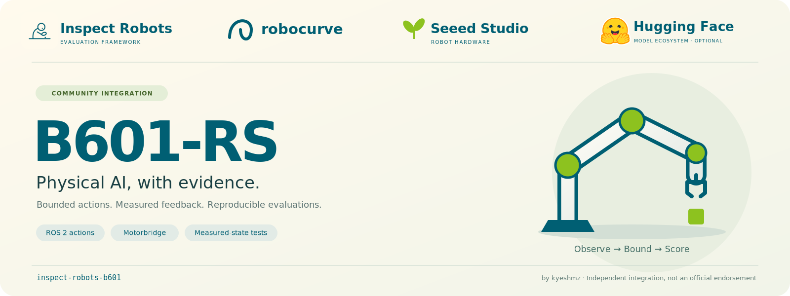

[](docs/quickstart.md)

<div align="center">

# inspect-robots-b601

Seeed reBot Arm **B601-RS** adapters and measured-state benchmarks for
[Inspect Robots](https://github.com/robocurve/inspect-robots).

[](#scope-and-safety)
[](https://github.com/kyeshmz/inspect-robots-b601/actions/workflows/ci.yml)
[](https://github.com/kyeshmz/inspect-robots-b601/actions/workflows/quality.yml)
[](https://github.com/kyeshmz/inspect-robots-b601/actions/workflows/official-mock.yml)
[](https://github.com/kyeshmz/inspect-robots-b601/releases/tag/v0.4.0)
[](docs/versioning.md)
[](https://github.com/robocurve/inspect-robots/releases/tag/v0.60.0)
[](CONTRIBUTING.md)

[Quickstart](docs/quickstart.md) · [Adapter reference](docs/adapters.md) ·
[Testing](docs/testing.md) · [Ecosystem](docs/ecosystem.md) ·
[Contributing](CONTRIBUTING.md)

</div>

Independent community integration by [kyeshmz](https://github.com/kyeshmz).
Not officially supported or endorsed by RoboCurve, Seeed Studio, or Hugging Face.
The Hugging Face artwork identifies an optional model ecosystem, not a bundled
client or a working checkpoint integration. See [artwork attribution](assets/NOTICE.md).

> [!WARNING]
> This is a local-only alpha adapter, not a commissioned physical controller.
> Direct Motorbridge controls **joint1 only**. Joints2-6 are observed, not held.
> Physical tracking readiness remains unresolved. Start without a robot.

## Install

Use Linux with Python **3.10 through 3.12**. The example uses Python 3.12.
Install that interpreter first if `python3.12` is not on your path.

```bash
python3.12 -m venv .venv
source .venv/bin/activate
python -m pip install 'https://github.com/kyeshmz/inspect-robots-b601/releases/download/v0.4.0/inspect_robots_b601-0.4.0-py3-none-any.whl'
inspect-robots list embodiments
```

The list includes `b601_ros` and `b601_motorbridge`. Installation and discovery
do not connect to hardware. Downloads need network access, but the checks below
need no ROS, CAN interface, robot, model key, or network service.

The package is **not published to PyPI**. Use the release wheel above, not
`pip install inspect-robots-b601`. See [publishing status](docs/publishing.md).
Inspect stays pinned to 0.60.0 and NumPy below 2 for the reviewed Humble ABI.

### Add the optional agent

In the same environment, install the tested RoboCurve agent plugin:

```bash
python -m pip install 'inspect-robots-agent==0.28.0'
python -m pip check
inspect-robots list policies
```

Expect `agent` alongside `b601_scripted`. The public v0.4.0 wheel and the branch
wheel pass an [offline agent evaluation, JSON log, and HTML report check](docs/testing.md#installed-wheel-agent-acceptance)
with Inspect 0.60.0 and agent 0.28.0. That check uses fake ROS I/O and mocked
provider responses, not a running model or robot. Other plugins have
[separate compatibility requirements](docs/ecosystem.md#tested-package-compatibility).

## Check the adapter without a robot

Run this in the activated environment:

```bash
python - <<'PY'
import sys

from inspect_robots.conformance import assert_embodiment_conformant
from inspect_robots_b601 import B601Embodiment

robot = B601Embodiment()
try:
    assert_embodiment_conformant(robot.info)
    assert robot.info.action_space.shape == (6,)
    assert robot.info.is_simulated
    assert not {"rclpy", "motorbridge"} & sys.modules.keys()
    print("B601 ROS contract OK. No hardware connected.")
finally:
    robot.close()
PY
```

Expect `B601 ROS contract OK. No hardware connected.` This checks metadata and
lazy imports, not robot motion. The default `simulated=True` selects the
official ROS mock backend. It is not an in-process simulator. Calling `reset()`
requires ROS and a running verified mock.

For a scored motion trial, follow the [official ROS mock quickstart](docs/quickstart.md#run-the-official-ros-mock).
Keep physical commissioning separate.

## What the package provides

Inspect Robots separates the robot interface, or `Embodiment`, from the
controller, or `Policy`. This package provides two embodiments and a bounded
scripted policy, not a pretrained B601 VLA.

| Component | Registered name | Contract |
| --- | --- | --- |
| ROS embodiment | `b601_ros` | Six absolute targets in `joint1` through `joint6` order, in ROS joint radians. Optional calibrated gripper and compressed cameras. |
| Direct embodiment | `b601_motorbridge` | One absolute joint1 target in raw motor radians. Observes all six joints. Deployment-specific commissioning only. |
| Hold task | `b601/hold` | Target the initial measured pose. |
| Nudge task | `b601/joint1-nudge` | Target a small joint1 offset from the initial measured pose. Score other-joint drift. |
| Policy | `b601_scripted` | Deterministic, bounded absolute joint targets. |
| Scorer | `b601_measured_goal` | Check measured final error, non-target drift, and observed overshoot. |

The public classes are `B601Embodiment` and `MotorbridgeB601Embodiment`.
Both constructors avoid hardware connections. Motorbridge construction requires
an explicit profile. No default robot calibration is shipped.
See [action units, observations, and lifecycle](docs/adapters.md).

## Choose the next step

| Goal | Guide | Requirements |
| --- | --- | --- |
| Develop or run regression tests | [Contributing](CONTRIBUTING.md) | A source checkout and the `dev` extra. Fake hardware and mocked model responses. |
| Test ROS behavior without a robot | [Testing and simulation](docs/testing.md) | ROS 2 Humble with fake action servers or the official Seeed mock. |
| Understand the local runtime | [Operator and robot computers](docs/quickstart.md#operator-and-robot-computers) | The robot host's sourced ROS workspace or reviewed CAN/SDK setup. |
| Review a physical joint1 trial | [Physical commissioning](docs/physical-commissioning.md) | A qualified operator, reviewed profile, existing stop state, supported arm/load, and independent cutoff. |
| Evaluate optional model integrations | [Ecosystem and prerequisites](docs/ecosystem.md) | Compatible observations, actions, checkpoint, and separate qualification. |

The package provides no remote-control transport, hosted service, pairing, or
app credentials. Control, profiles, and persistent stop state stay on the robot
computer. Use your existing shell access and file-transfer method when the
operator computer is elsewhere.

## Scope and safety

- ROS executes one action at a time with fresh feedback. These are not
  collision-checked MoveIt plans. Physical bounds and gripper endpoints need
  calibration in the driver's coordinate frame.
- Direct Motorbridge has no camera, gripper, Cartesian IK, homing, zeroing, or
  full-arm control. Its deployment-specific can1/PCAN identity, native-owner
  locks, legacy stop evidence, and verified SDK hashes remain required.
- No automatic controller handoff, stop acknowledgement, recovery, gain
  increase, or full-arm activation is provided. Worker HOLD and disable
  acknowledgements do not prove physical torque-off.
- A completed run is not necessarily a successful task. The scorer reads
  recorded measured positions, not policy targets. Recorded samples do not
  certify continuous-time motion or physical safety.
- Software, ROS protocol, official mock, optional paid agent simulation, and
  physical commissioning are separate [test stages](docs/testing.md).
  Stop on failure. No stage automatically starts a physical trial.

Quality CI checks Ruff, strict mypy, the public API snapshot, version metadata,
and branch coverage with a **75% offline floor**, including ROS code that cannot
execute locally without ROS. This is not upstream's 100% coverage gate or a
physical safety certificate. Both Python packages ship `py.typed`.

See [compatibility and versioning](docs/versioning.md), [the changelog](CHANGELOG.md),
and [release artifacts](https://github.com/kyeshmz/inspect-robots-b601/releases/tag/v0.4.0).
Checkout documentation follows its branch. The `v0.4.0` tag preserves the release
documentation. No project license has been selected; upstream license badges
do not apply to this repository.
