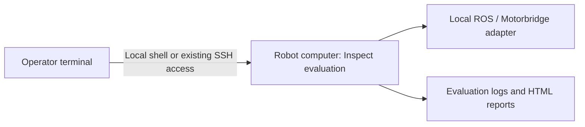

# Start without a robot

This repository is an installable **Inspect Robots B601 adapter**, not a hosted
service or a remote-control stack. No cloud account, app credentials, pairing,
broker or extra network transport is needed.

First discover the adapters and check their metadata. Then choose development
tests or the official ROS mock. Physical control remains a separate reviewed,
operator-only commissioning stage.

## Install the release

On a Linux computer with Python **3.10 through 3.12**, create an environment.
The example uses Python 3.12. Install that interpreter first if `python3.12`
is not on your path.

```bash
python3.12 -m venv .venv
source .venv/bin/activate
python -m pip install 'https://github.com/kyeshmz/inspect-robots-b601/releases/download/v0.4.0/inspect_robots_b601-0.4.0-py3-none-any.whl'
inspect-robots list embodiments
```

The registry lists `b601_ros` and `b601_motorbridge`. No connection occurs.
Run the [README contract example](../README.md#check-the-adapter-without-a-robot)
to check the six-joint ROS declaration without importing ROS or Motorbridge.
Expect `B601 ROS contract OK. No hardware connected.`

This proves plugin discovery and metadata conformance, not simulated motion.
The default `simulated=True` selects the official ROS mock. It still needs ROS
at `reset()`. No ROS installation is needed for the contract example.

The package is not published to PyPI. Use the wheel URL, not the bare package
name. See [publisher setup](publishing.md). No cloud account or robot credentials
are needed. Installation downloads need network access.

## Develop from a checkout

Use a separate directory and environment for development:

```bash
git clone https://github.com/kyeshmz/inspect-robots-b601.git
cd inspect-robots-b601
python3.12 -m venv .venv
source .venv/bin/activate
python -m pip install -e '.[dev]'
python -m pytest
python -m mypy
```

Expect passing software tests and typing. The tests use fake hardware and
mocked model responses, without ROS, CAN, a robot, or paid inference. See
[contributing](../CONTRIBUTING.md) for the complete quality gates.

## Operator and robot computers

They can be the same computer or different computers:

| Role | What belongs there |
| --- | --- |
| Operator computer | Source checkout, software tests and report viewing. No motor SDK, calibration or robot connection is needed for these. |
| Robot computer | The actual Inspect runtime, its local ROS/CAN connection, reviewed profile and existing persistent stop state. |



If the robot is a different computer, run the robot-side commands there, either
locally or in your existing administrative SSH shell. This package does not
configure SSH, add a network service, expose ROS to the Internet, or implement a remote
command protocol. Do not copy robot calibration or stop-state files to the
operator computer just to run the software tests.

## Run the official ROS mock

Use Ubuntu 22.04 / ROS 2 Humble and its **system Python 3.10**. The Seeed ROS
workspace must already be built. This Python package does not install or start
a hardware driver. Use a separate `.venv-ros` with system packages available:

```bash
/usr/bin/python3 -m venv --system-site-packages .venv-ros
source .venv-ros/bin/activate
python -m pip install 'pip==25.3'
python -m pip install 'https://github.com/kyeshmz/inspect-robots-b601/releases/download/v0.4.0/inspect_robots_b601-0.4.0-py3-none-any.whl'
```

In both robot-side terminals, source the runtime and the reviewed workspace:

```bash
source /opt/ros/humble/setup.bash
source /path/to/ros2_ws/install/setup.bash
source .venv-ros/bin/activate
export ROS_DOMAIN_ID=61 ROS_LOCALHOST_ONLY=1
export RMW_IMPLEMENTATION=rmw_cyclonedds_cpp
unset ROS_DISCOVERY_SERVER ROS_STATIC_PEERS
```

Robot terminal one:

```bash
ros2 launch rebotarm_moveit_config demo.launch.py model:=rs use_rviz:=false
```

Robot terminal two, **one evaluation at a time**:

```bash
inspect-robots doctor --embodiment b601_ros
b601-evaluate ros-mock --task hold --log-dir logs/ros-hold
b601-evaluate ros-mock --task joint1-nudge --log-dir logs/ros-nudge
```

The adapter verifies the official `ReBot_Arm_RS` / `GenericSystem` mock before
any goal. Success requires both `status: success` and `b601_measured_goal: 1.0`;
dispatching a command is not sufficient. No model API or real motor is used.
Stop with Ctrl-C in the mock launch terminal when finished.

Alternatively, dispatch the repository's **Official Seeed mock** Actions workflow
to build and check the pinned mock on a hosted runner, with no robot involved.
See [the complete testing guide](testing.md) for ROS protocol tests and optional
explicitly acknowledged agent-in-simulation runs.

## View the results

On the machine that contains the logs:

```bash
inspect-robots view logs/
```

This renders HTML reports. If the operator is elsewhere, copy the logs/reports
using your existing file-transfer method and open them locally. Report viewing
does not require access to the robot and does not start another controller.

## Keep physical commissioning separate

Direct Motorbridge remains **joint1-only**; joints2–6 are observed, not held.
Use the robot's actual reviewed profile and its existing shared state directory.
The package does not hand over a controller, home an arm, clear a stop, calibrate
motors or enable all axes automatically.

Before real CAN access or motion, follow the
[operator commissioning procedure](physical-commissioning.md), with the entire
arm/load supported and an independent cutoff available. Physical tracking
qualification remains unresolved. A passing repository or mock test does not
make an uncommissioned robot safe to operate.
