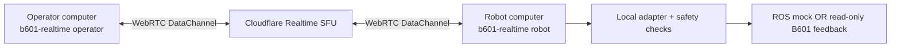

# Operator computer and robot computer

**No Cloudflare Tunnel, SSH port-forward or public ROS endpoint is required.**
The optional `realtime` extra connects two **trusted Python CLI processes** to
a new Cloudflare Realtime SFU app. The operator does not need ROS, CAN hardware,
robot calibration or the motor SDK.



Both endpoints make outbound HTTPS signaling requests and outbound WebRTC
connections. The control loop, ROS graph, CAN ownership, local limits and logs
stay on the robot computer. This first version carries **status and fixed
simulation-task requests**, not video, arbitrary joint targets or remote
physical activation.

Commands labeled **robot computer** run on that machine, either at its local
terminal or in an ordinary administrative SSH shell. SSH is not the Realtime
transport and no port-forward is needed. Keep the operator CLI running on the
operator computer, not inside that robot-side shell.

## Who installs what?

| | Operator computer | Robot computer |
| --- | --- | --- |
| Python | 3.10–3.12; Linux is the tested platform | 3.10–3.12; Humble uses Ubuntu 22.04/system Python 3.10 |
| Package | `realtime` extra | `realtime` extra; add `motorbridge` only for reviewed physical reads |
| Realtime credentials | Same app and pairing key, on a trusted private machine | Same app and pairing key, on a trusted private machine |
| ROS | Not needed | Needed only for `ros-mock`; source the reviewed workspace |
| Profile / persistent state | Never copied here | Existing reviewed local paths only |
| Motor enable / recovery | Not a network capability | Separate local operator-only commissioning procedure |

## 1. Install on both computers

Use an existing Python **3.10–3.12**. For example, on the operator computer:

```bash
python3.12 -m venv ~/.venvs/b601
source ~/.venvs/b601/bin/activate
python -m pip install 'pip==25.3'
python -m pip install 'inspect-robots-b601[realtime] @ https://github.com/kyeshmz/inspect-robots-b601/releases/download/v0.3.0/inspect_robots_b601-0.3.0-py3-none-any.whl'
```

That installs the release wheel and optional dependencies without Git. You can
also download the wheel from the [v0.3.0 release](https://github.com/kyeshmz/inspect-robots-b601/releases/tag/v0.3.0)
and install the file, then its optional dependencies:

```bash
python -m pip install ./inspect_robots_b601-0.3.0-py3-none-any.whl
python -m pip install 'inspect-robots-b601[realtime]==0.3.0'
```

The second command can use the already installed distribution's extra metadata;
it does not require the base package to have been published on PyPI. The project
has a prepared PyPI publishing workflow, but `pip install inspect-robots-b601`
by name requires the one-time [PyPI publisher setup](publishing.md).

On the robot computer, create the venv with its ROS system Python if ROS is
needed, then use the same package install command:

```bash
python3 -m venv --system-site-packages ~/.venvs/b601
source ~/.venvs/b601/bin/activate
python -m pip install 'pip==25.3'
python -m pip install 'inspect-robots-b601[realtime] @ https://github.com/kyeshmz/inspect-robots-b601/releases/download/v0.3.0/inspect_robots_b601-0.3.0-py3-none-any.whl'
```

Check the install on either computer without connecting to anything:

```bash
inspect-robots list embodiments
b601-realtime --help
b601-realtime --version
```

Installing a package never creates a cloud app, opens CAN or enables motors.

## 2. Create one Realtime app and configure both trusted computers

Create a **Realtime SFU app**, not a Tunnel, following Cloudflare's
[SFU setup guide](https://developers.cloudflare.com/realtime/sfu/get-started/).
Record its App ID and keep the App Secret private. The App ID is a locator,
not a credential. Generate one independent pairing key:

```bash
python -c 'import secrets; print(secrets.token_urlsafe(32))'
```

On **each** trusted computer, save the same three values in a private file such
as `~/.config/inspect-robots-b601/realtime.env`, with permissions `0600`:

```bash
export CLOUDFLARE_REALTIME_APP_ID='YOUR_APP_ID'
export CLOUDFLARE_REALTIME_APP_SECRET='YOUR_APP_SECRET'
export B601_REALTIME_KEY='YOUR_GENERATED_PAIRING_KEY'
```

Load it in each terminal that runs a Realtime endpoint:

```bash
source ~/.config/inspect-robots-b601/realtime.env
```

These are **privileged backend CLIs**. Anyone holding the App Secret has broad
access to this SFU app. Use a dedicated app; share credentials only with trusted
operators. Do not put them in a browser, an invite, a repository or a report.
This is not a multi-tenant/browser authorization service. Cloudflare SFU
terminates WebRTC transport encryption; HMAC message authentication is not
end-to-end encryption from the provider.

Synchronize both clocks (NTP). Requests more than five seconds old or in the
future are rejected. Allow outbound WebRTC traffic. If the network requires
TURN, configure all three optional TURN variables in `.env.example`; partial
TURN configuration is rejected. No inbound listener or tunnel is used.

## 3. First check: Realtime only, no robot

**Robot computer:**

```bash
b601-realtime robot --backend echo
```

It prints an operator command containing a fresh invite. Copy that command to
the **operator computer**, which already has its private environment loaded:

```bash
b601-realtime operator --invite PASTE_THE_PRINTED_INVITE
```

Expected result: `event: status`, `backend: echo`, `robot_connected: false`.
That is a successful communication check, not a fake sensor reading. The invite
contains publication identifiers, not the App Secret or pairing key. It is only
valid while that robot endpoint is running.

Each operator invocation sends one request. Reuse the invite for another
explicit request; the receiver checks a fresh signed request ID, origin,
sequence and timestamp. There is no automatic command retry or reconnect. A
timeout means **outcome unconfirmed**: check status/logs before deciding to retry.

For a live status view on one persistent connection, use `--watch` and Ctrl-C
to leave it:

```bash
b601-realtime operator --invite INVITE --watch
```

Keep one operator process active at a time; close the watch before submitting a
task or stop from another invocation. Watching is observation-only. A reported
`state_age_s` is the sample age on the robot before transmission, not a promise
of zero Internet latency.

## 4. Run a measured benchmark on the robot-side ROS mock

Stop the echo endpoint first. On the **robot computer**, source Humble and the
reviewed Seeed overlay in both terminals. Keep the existing local mock isolation:

```bash
export ROS_DOMAIN_ID=61 ROS_LOCALHOST_ONLY=1
export RMW_IMPLEMENTATION=rmw_cyclonedds_cpp
unset ROS_DISCOVERY_SERVER ROS_STATIC_PEERS
```

Robot terminal one:

```bash
ros2 launch rebotarm_moveit_config demo.launch.py model:=rs use_rviz:=false
```

Robot terminal two, with the package venv and private Realtime environment loaded:

```bash
b601-realtime robot --backend ros-mock
```

On the **operator computer**, use the newly printed invite, **one request at a time**:

```bash
b601-realtime operator --invite INVITE --request status
b601-realtime operator --invite INVITE --request hold
b601-realtime operator --invite INVITE --request joint1-nudge
```

The robot verifies the `GenericSystem` mock, applies its local guards, runs a
three-step deterministic Inspect task and returns a measured score. `accepted`
is not completion; wait for `event: result` and `passed: true`. Busy endpoints
reject another run rather than queue it. Robot-side logs default to
`logs/realtime/`. No model API is called by these commands.

To latch a stop on this endpoint:

```bash
b601-realtime operator --invite INVITE --request stop
```

An active mock task checks the stop before its next action. Loss of operator
heartbeats also latches the active mock run; an in-flight bounded trajectory can
finish. This is **not** a physical emergency stop. A stopped/faulted endpoint
requires an explicit local restart and fresh invite; the network cannot recover
it. Ctrl-C on the robot terminal closes its owned session and resources.

## 5. Physical feedback, without remote movement

Only after arranging the existing reviewed controller handoff and hardware
prerequisites, install the `motorbridge` extra **on the robot computer** and use:

```bash
b601-realtime robot --backend motorbridge-read \
  --profile /absolute/path/to/reviewed-profile.json \
  --state-dir /absolute/path/to/existing/.hardware-state
```

An authenticated `status` request opens/reads CAN locally but never enables a
motor. Ordered `arm_joint_pos` is joint1–joint6 in **raw motor radians**, which
are not necessarily the ROS driver's coordinates. `endpoint_stopped` describes
this network process, not electrical torque or the durable motor-stop ledger.
The reply always reports `physical_activation_available: false`.

The operator never receives the profile or SDK and cannot request enable,
recovery, home, gains, arbitrary joints or physical task execution. Local
commissioning stays in the [separate operator procedure](physical-commissioning.md).

## What has been verified?

Offline tests exercise authentication, replay/age rejection, bounded buffers,
mocked Cloudflare REST/SDP allocation/cleanup, and actual local aiortc WebRTC
DataChannel delivery/replies through an SFU contract fake. They do not prove a
live Cloudflare app is configured. Live cloud testing needs your app credentials
and may incur provider traffic charges. Physical readiness remains unresolved.

## If something fails

| Message / symptom | Where to check |
| --- | --- |
| Missing environment variable | Load the private env file in **that computer's terminal**, then rerun. |
| HTTP 401/403 | Check the dedicated SFU App ID/App Secret, not a Tunnel token or account-wide API token. |
| Message authentication failed | Both computers must use the same pairing key and the current robot invite. Restart locally for a fresh invite. |
| Stale message / unsynchronized clocks | Synchronize both system clocks with NTP; do not weaken the five-second deadline. |
| Negotiation timeout | Check outbound WebRTC connectivity and whether the network requires the optional TURN configuration. |
| Busy / accepted but no confirmed result | Do not queue or automatically repeat a task. Check robot-side logs/status first. |
| Remote motion is simulation-only | The endpoint is intentionally not a physical actuator API. Use the local commissioning procedure. |
